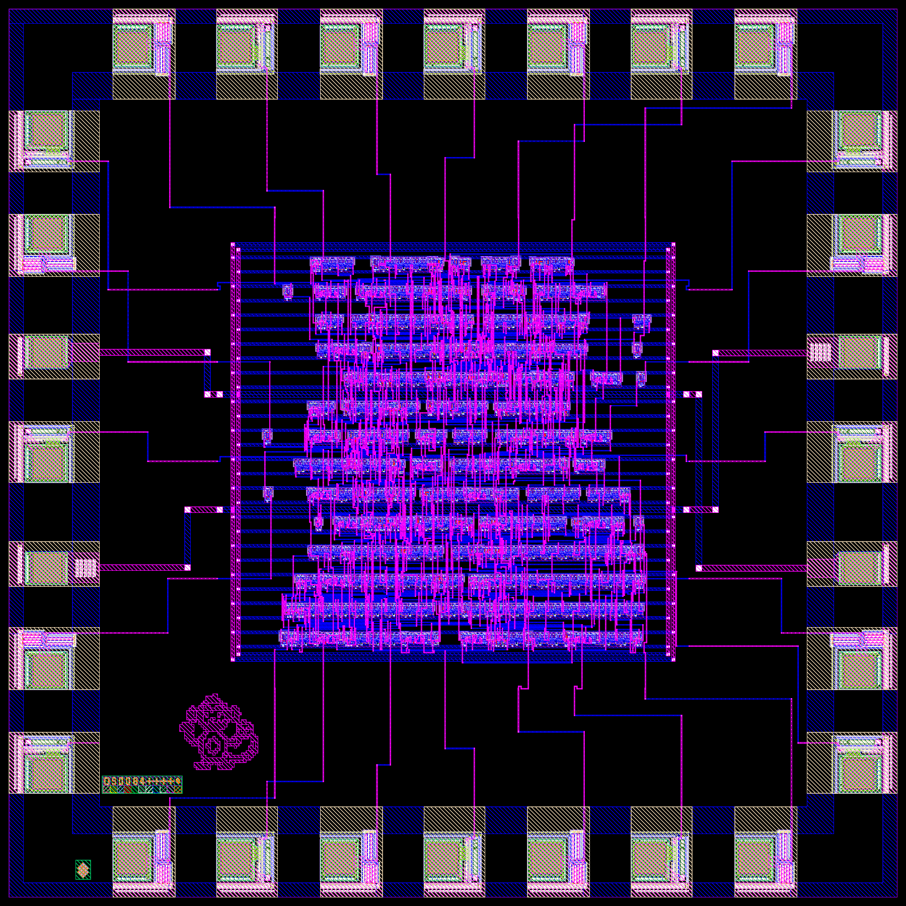
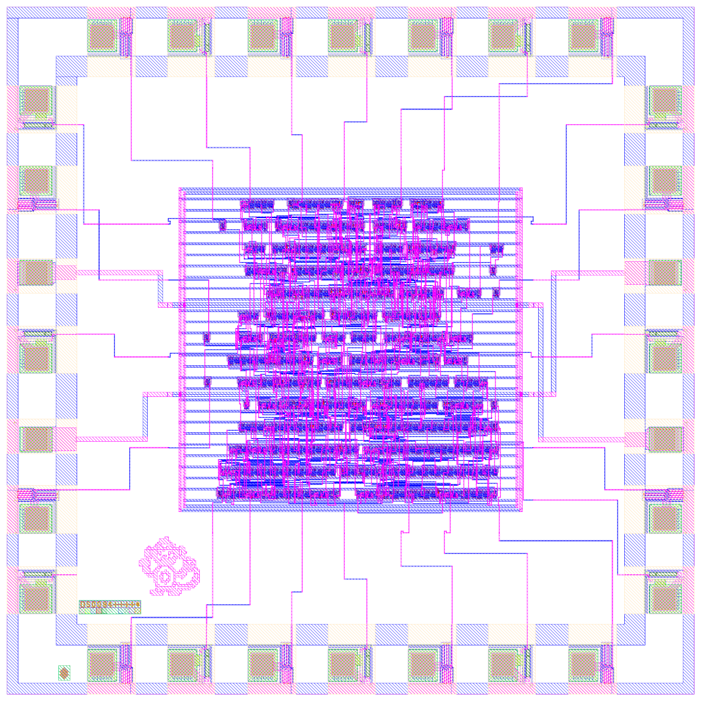
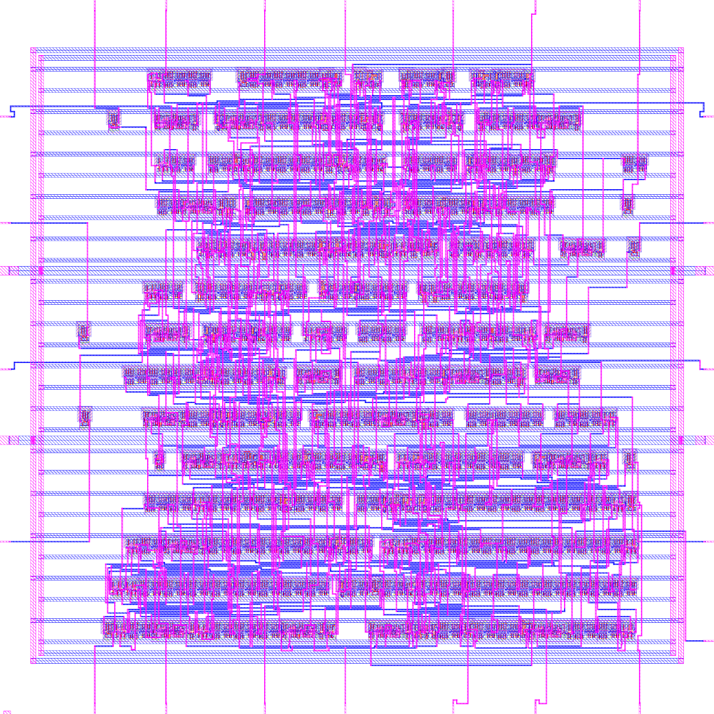
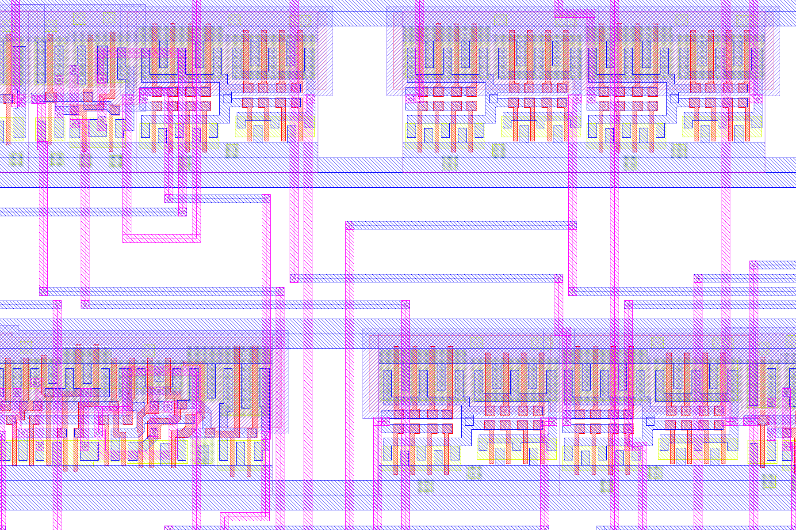
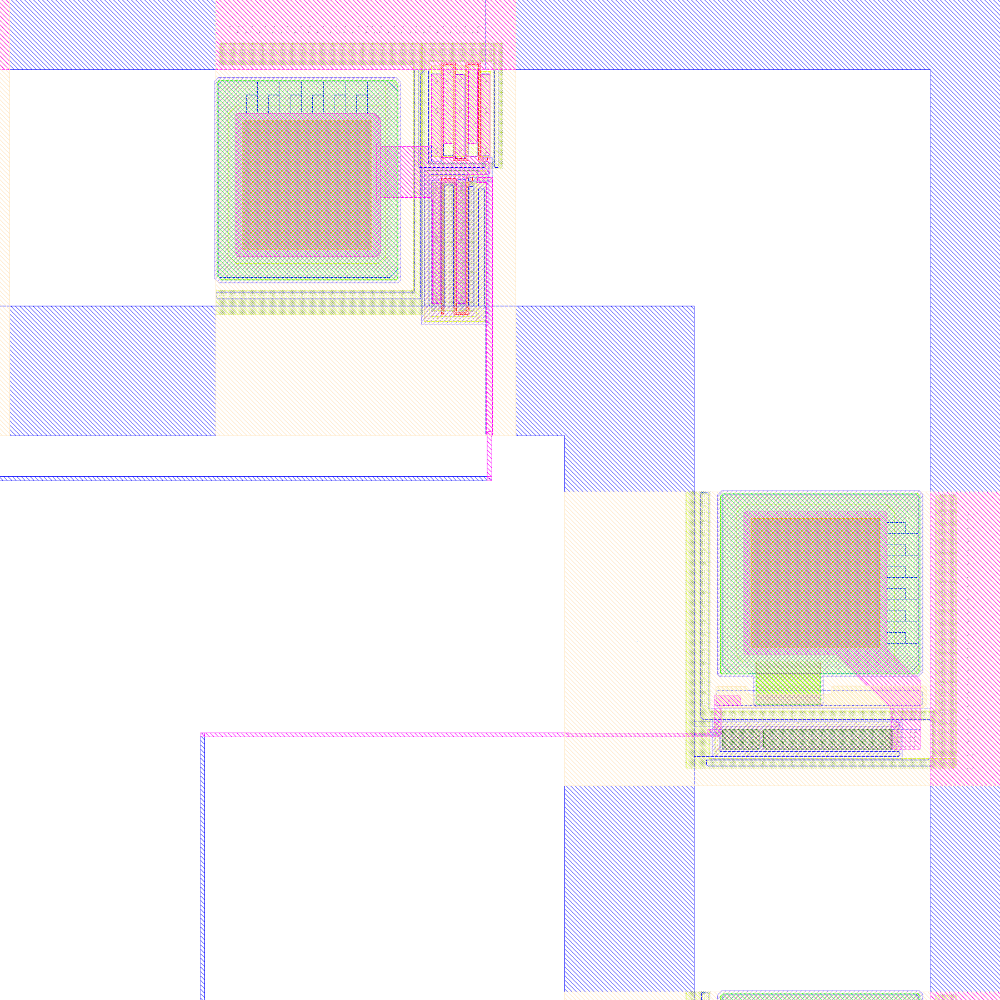
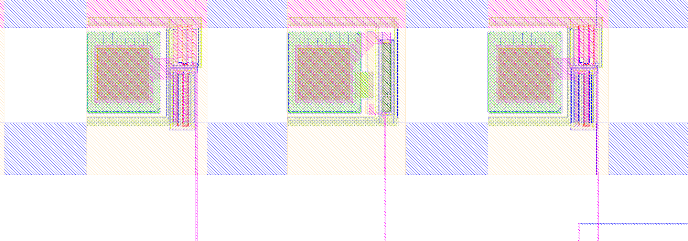
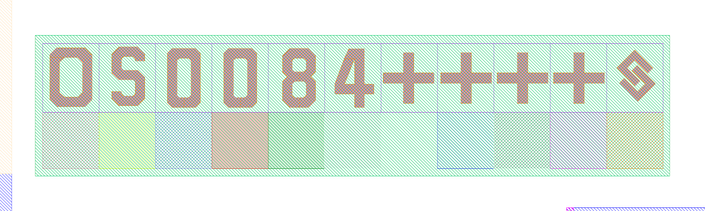

# acc4cpu: 4-bit accumulator CPU on SCL 1.2 um C1D (Silicon No. OS0084)

A 4-bit accumulator CPU taped out on SCL's 1.2 um C1D open PDK, in the standard 3 mm x 3 mm pad frame
(28-pin DIP chip-on-board).

- **ISA:** 8-bit instructions, `[7:5]` opcode, `[4:0]` address, 32-word external memory.
  LOAD, STORE, ADD, SUB, AND, OR, JMP, JZ. JMP to its own address = HALT. 2 clocks per instruction.
- **Pins:** even pads = inputs (IPAD00): clk, rst_n, run, din[7:0]. Odd pads = outputs (OPAD04): addr[4:0],
  dout[3:0], rd, we, halt. 2 x PVDD01 / 2 x PVSS01. Full pad map in `rtl/acc4_top.v`.
- **Timing:** signed off at 10 MHz (100 ns), worst setup slack +74.96 ns, hold +2.03 ns.
- **Verification:** RTL, ALU (1,024 cases), gate-level and post-layout SDF simulation pass at min/typ/max; LVS match;
  DRC 0 violations with `c1d_drc.drc` v1.1.

## Size and process

| | |
|---|---|
| Die | 3 mm x 3 mm = 9 mm² |
| Core (routed block) | 1.6 mm x 1.6 mm = 2.56 mm² |
| Standard-cell area | 0.66 mm² (310 cells, 19 flip-flops; about 26 % of the core) |
| Transistors | about 4,300 (cell count x transistors per cell from SCL's cell netlists) |
| Density | about 6,600 transistors / mm² of cell area, about 480 / mm² of die |
| Clock | 10 MHz |

**What "1.2 um" means here.** On SCL C1D the name is a real dimension: the minimum drawn gate length of an NMOS
transistor is 1.2 um (PMOS 1.5 um). Other minimum rules from SCL's DRC deck (`c1d_drc.drc` v1.1): poly width
1.2 um, diffusion width 2.5 um, metal1 2.4 um wide / 1.5 um spacing, metal2 2.5 um wide / 1.7 um spacing. It is a
planar n-well CMOS process with two metal layers. One flip-flop (`DFCL11`) is 100.8 um x 48.7 um.

**Compared with a "2 nm" chip.** Modern node names are generation labels, not measurements: nothing on a "2 nm"
chip is 2 nm wide. A 2 nm-class process has gate lengths of roughly 12-16 nm, metal pitches of roughly 20-25 nm,
gate-all-around nanosheet transistors, 15+ metal layers and roughly 200-300 million transistors per mm², about
40,000 times this chip's density. Up to the 1990s node names did match the gate length, as 1.2 um does here
(the Intel 80386 of 1985 used a similar 1.5 um process).

## Images

Rendered from the final submitted GDS with KLayout (`flow/render_images.py`).

| | |
|---|---|
|  |  |
| **The whole 3 mm x 3 mm die:** 24 signal pads and 4 power pads, channel wiring, the routed core, the chip art and the Silicon No. block | Same view on a light background |
|  |  |
| **The routed core** (about 1.6 mm square): 14 standard-cell rows, power ring, metal1/metal2 routing | **Close-up of two cell rows:** VDD/VSS rails, transistors, contacts and vias |
|  |  |
| **Pad ring corner:** bond pads with their driver/ESD structures | **Pads along the top edge,** wired into the core |
|  |  |
| **The monkey:** chip art in metal2 | **The OS0084 Silicon No. block** as placed on the die |

More figures (block diagram, FSM, design flow) are in `docs/img/` and the teaching guide in `docs/`.

## Layout of this repo

| Folder | Contents |
|---|---|
| `rtl/` | Verilog-2005 RTL: `acc4_cpu.v` (core FSM), `acc4_alu.v`, `acc4_core.v`, `acc4_top.v` (chip top + pads) |
| `tb/` | Self-checking testbenches, simulation logs and waveform |
| `syn/` | Yosys scripts, logs and synthesised netlists |
| `flow/` | Place-and-route, GDS assembly and check scripts (OpenROAD in the OpenLane 1.0.2 container, KLayout) |
| `pnr/` | DEFs per P&R stage, routed and power netlists, pin placement |
| `signoff/` | STA at min/typ/max: SDF, SPEF, timing and DRV reports |
| `lvs/` | Design netlists for LVS |
| `checks/` | DRC / LVS logs and DRC marker databases, grid audit, submission DRC reports |
| `layout/art/` | Chip art (metal-only) |
| `images/` | KLayout renders of the final chip (made by `flow/render_images.py`) |
| `submission/` | DRC report and MD5 of the submitted v3 GDS |
| `docs/` | Runbook, teaching guide, diagrams, KLayout 2.5D script |

## Not in this repo

These are SCL's or are not redistributable:

- the SCL C1D PDK and anything copied from it: standard-cell / IO-pad libraries (LEF, CDL, Verilog models),
  the pad frame, the DRC/LVS decks
- GDS files that contain SCL cells or the pad frame (core, chip and submission GDS), the OpenROAD database,
  transistor-level LVS extractions, and compiled simulations that bundle SCL's cell models
- the SCL-issued Silicon No. block and requisition, and the submission paperwork

To rebuild, get the PDK from SCL / eChipHub, put it under `~/scl/` as the scripts expect, and follow `docs/RUNBOOK.md`.
